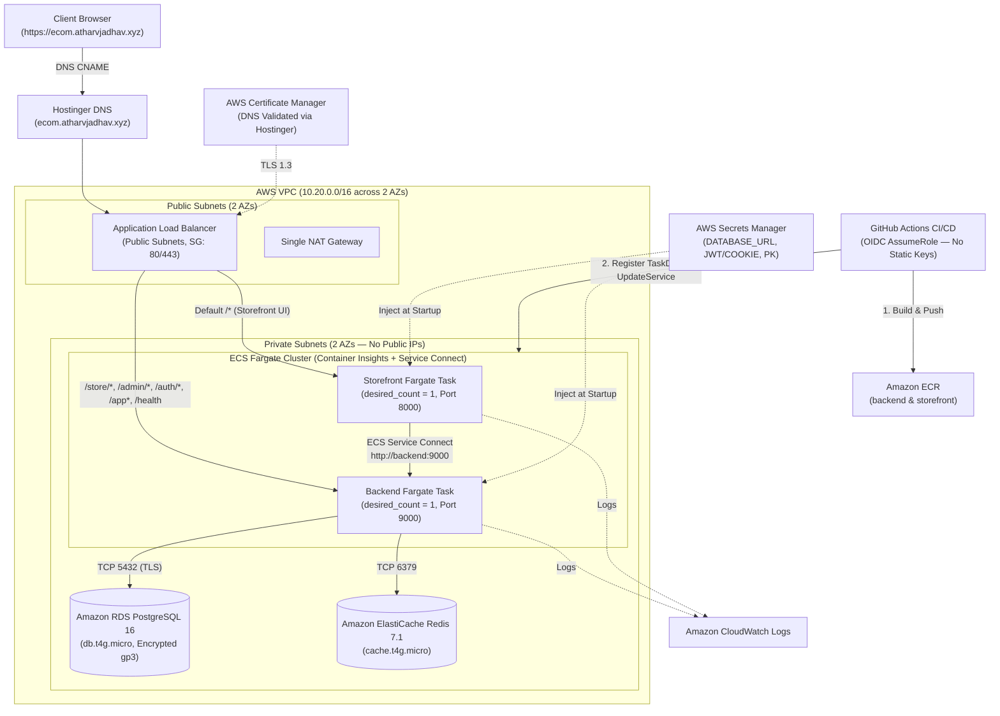

# Medusa Ecommerce Monorepo — AWS ECS Fargate Deployment Guide (Phase 4)

This guide documents the production AWS infrastructure provisioned via Terraform under [`infra/terraform/`](../infra/terraform/) and the automated GitHub Actions OIDC Continuous Deployment pipeline in [`.github/workflows/deploy-aws.yml`](../.github/workflows/deploy-aws.yml).

> [!NOTE]
> Local development (`compose.yaml`) and local Kubernetes (`k8s/`) remain completely intact and unaffected by this AWS setup.

---

## 1. AWS Architecture Overview



### Key Architectural Decisions

1. **Compute (`desired_count = 1` per service, No Autoscaling)**:
   - Runs 1 Fargate task for `backend` (`1 vCPU / 2048 MiB`) and 1 Fargate task for `storefront` (`0.5 vCPU / 1024 MiB`) inside private subnets (`assign_public_ip = false`).
2. **ALB Path-Based Routing on a Single Origin**:
   - Requests matching `/store/*`, `/admin/*`, `/auth/*`, `/app`, `/app/*`, and `/health` route to the **Backend Target Group (`:9000`)**.
   - All other requests (`/*`, `/dk/*`, `/_next/*`) route to the **Storefront Target Group (`:8000`)**.
   - Because both services share the same public origin (`http://<alb-dns-name>` or `https://ecom.atharvjadhav.xyz`), session and auth cookies (`connect.sid`, `_medusa_jwt`, `_medusa_cart_id`) work natively as first-party `sameSite: "lax"` cookies.
3. **Internal SSR Service Discovery (`http://backend:9000`)**:
   - ECS Service Connect (`medusa-ecomm-production.internal`) registers `backend:9000` inside the VPC so Next.js Server Components and Middleware reach Medusa directly over the private network via `MEDUSA_BACKEND_URL=http://backend:9000`.
4. **Secrets & Least-Privilege Security**:
   - Terraform generates strong random values for the RDS password, `JWT_SECRET`, and `COOKIE_SECRET` and stores them alongside `DATABASE_URL` and `STOREFRONT_PUBLISHABLE_KEY` in **AWS Secrets Manager**.
   - The ECS Task Execution Role has permission to read **only** that specific secret ARN.
   - Security Groups enforce strict tier-to-tier chaining (`Internet -> ALB -> ECS Tasks -> RDS/Redis`).

---

## 2. Step-by-Step Deployment Guide

### Step 1: Configure `terraform.tfvars`

```bash
cd infra/terraform
cp terraform.tfvars.example terraform.tfvars
```

Edit `infra/terraform/terraform.tfvars` (which is gitignored):

```hcl
aws_region                  = "us-east-1"
project_name                = "medusa-ecomm"
environment                 = "production"
domain_name                 = "ecom.atharvjadhav.xyz"
enable_https                = false # Keep false for Stage 1 until Hostinger DNS CNAME is verified
github_repository           = "atharvjadhav-dev/ecomm"
github_branch               = "main"
create_github_oidc_provider = true
backend_desired_count       = 1
storefront_desired_count    = 1
storefront_publishable_key  = "pk_47267c6066285a660ebb8491f6cfe576bab6b2df10c3c3d0f843f67ef4f5d027"
default_region_code         = "dk"
```

### Step 2: Provision AWS Infrastructure (Stage 1 — HTTP + ACM Certificate Request)

```bash
cd infra/terraform
terraform init
terraform validate
terraform plan
terraform apply
```

When `terraform apply` completes, inspect the outputs:

```bash
terraform output
```

You will receive:
- `alb_dns_name` & `alb_http_url` (e.g., `http://medusa-ecomm-production-alb-xxxx.us-east-1.elb.amazonaws.com`)
- `ecr_backend_repository_url` & `ecr_storefront_repository_url`
- `acm_dns_validation_records` (the CNAME record to validate `ecom.atharvjadhav.xyz`)
- `hostinger_cname_instructions` (the CNAME record pointing `ecom.atharvjadhav.xyz` to the ALB)
- `github_actions_role_arn` (for GitHub Actions OIDC)

### Step 3: Push Initial Images to ECR & Trigger ECS Rollout

From the repository root, authenticate Docker to ECR, build both images using your existing Dockerfiles, push them, and force an initial ECS deployment:

```bash
AWS_REGION="us-east-1"
BACKEND_ECR=$(terraform -chdir=infra/terraform output -raw ecr_backend_repository_url)
STOREFRONT_ECR=$(terraform -chdir=infra/terraform output -raw ecr_storefront_repository_url)
ALB_URL=$(terraform -chdir=infra/terraform output -raw alb_http_url)
CLUSTER=$(terraform -chdir=infra/terraform output -raw ecs_cluster_name)
BE_SVC=$(terraform -chdir=infra/terraform output -raw ecs_backend_service_name)
SF_SVC=$(terraform -chdir=infra/terraform output -raw ecs_storefront_service_name)

# 1. Authenticate Docker to Amazon ECR
aws ecr get-login-password --region "$AWS_REGION" | docker login --username AWS --password-stdin "${BACKEND_ECR%/*}"

# 2. Build and push Backend image
docker build -f apps/backend/Dockerfile -t "$BACKEND_ECR:latest" .
docker push "$BACKEND_ECR:latest"

# 3. Build and push Storefront image
docker build -f apps/storefront/Dockerfile \
  --build-arg NEXT_PUBLIC_MEDUSA_PUBLISHABLE_KEY="pk_47267c6066285a660ebb8491f6cfe576bab6b2df10c3c3d0f843f67ef4f5d027" \
  --build-arg NEXT_PUBLIC_MEDUSA_BACKEND_URL="$ALB_URL" \
  --build-arg NEXT_PUBLIC_BASE_URL="$ALB_URL" \
  --build-arg NEXT_PUBLIC_DEFAULT_REGION="dk" \
  -t "$STOREFRONT_ECR:latest" .
docker push "$STOREFRONT_ECR:latest"

# 4. Roll out the tasks on ECS
aws ecs update-service --region "$AWS_REGION" --cluster "$CLUSTER" --service "$BE_SVC" --force-new-deployment
aws ecs update-service --region "$AWS_REGION" --cluster "$CLUSTER" --service "$SF_SVC" --force-new-deployment
```

### Step 4: Configure Hostinger DNS & Enable HTTPS (Stage 2)

1. Open **Hostinger $\rightarrow$ Domains $\rightarrow$ `atharvjadhav.xyz` $\rightarrow$ DNS / Nameservers**.
2. Add the **ACM Validation CNAME** shown by `terraform output acm_dns_validation_records`:
   - **Type**: `CNAME`
   - **Name**: `_xxxx.ecom` (strip `.atharvjadhav.xyz.` if Hostinger auto-appends your root domain)
   - **Points to**: `_yyyy.acm-validations.aws.`
3. Add the **Subdomain Traffic CNAME** shown by `terraform output hostinger_cname_instructions`:
   - **Type**: `CNAME`
   - **Name**: `ecom`
   - **Points to**: `<alb_dns_name>` (e.g., `medusa-ecomm-production-alb-xxxx.us-east-1.elb.amazonaws.com`)
4. Once ACM shows the certificate status as **`ISSUED`** in the AWS Console (typically 2–5 minutes after saving in Hostinger), update `infra/terraform/terraform.tfvars`:
   ```hcl
   enable_https = true
   ```
   And run:
   ```bash
   terraform -chdir=infra/terraform apply
   ```
   This enables the HTTPS (`443`) listener, redirects HTTP (`80`) $\rightarrow$ HTTPS (`443`), and sets `COOKIE_SECURE=true` on both ECS services.

---

## 3. GitHub Actions OIDC CI/CD Configuration

The deployment workflow [`.github/workflows/deploy-aws.yml`](../.github/workflows/deploy-aws.yml) uses **OpenID Connect (OIDC)**—no long-lived `AWS_ACCESS_KEY_ID` or `AWS_SECRET_ACCESS_KEY` is ever stored in GitHub.

Configure the following in your GitHub repository under **Settings $\rightarrow$ Secrets and variables $\rightarrow$ Actions**:

### Repository Variables (`vars.*`)

| Variable Name | Example Value | Source |
| :--- | :--- | :--- |
| `AWS_REGION` | `us-east-1` | Your AWS region |
| `AWS_ROLE_ARN` | `arn:aws:iam::<ACCOUNT_ID>:role/medusa-ecomm-production-github-actions-deploy` | `terraform output -raw github_actions_role_arn` |
| `ECR_BACKEND_REPOSITORY` | `medusa-ecomm-production/backend` | Repository name part of `ecr_backend_repository_url` |
| `ECR_STOREFRONT_REPOSITORY` | `medusa-ecomm-production/storefront` | Repository name part of `ecr_storefront_repository_url` |
| `ECS_CLUSTER_NAME` | `medusa-ecomm-production-cluster` | `terraform output -raw ecs_cluster_name` |
| `ECS_BACKEND_SERVICE` | `medusa-ecomm-production-backend` | `terraform output -raw ecs_backend_service_name` |
| `ECS_STOREFRONT_SERVICE` | `medusa-ecomm-production-storefront` | `terraform output -raw ecs_storefront_service_name` |
| `PUBLIC_APP_URL` | `https://ecom.atharvjadhav.xyz` (or `alb_http_url`) | Public base URL for Next.js build args |
| `NEXT_PUBLIC_DEFAULT_REGION` | `dk` | Default storefront region code |

### Repository Secrets (`secrets.*`)

| Secret Name | Value |
| :--- | :--- |
| `NEXT_PUBLIC_MEDUSA_PUBLISHABLE_KEY` | Same `pk_...` publishable key set in `storefront_publishable_key` |

---

## 4. Verification & Monitoring Commands

```bash
# 1. Check ECS service status & running task counts
aws ecs describe-services \
  --cluster medusa-ecomm-production-cluster \
  --services medusa-ecomm-production-backend medusa-ecomm-production-storefront \
  --query "services[].{Name:serviceName,Status:status,Desired:desiredCount,Running:runningCount}" \
  --output table

# 2. Verify Backend Health, Admin UI, and Storefront via ALB / Domain
ALB_URL=$(terraform -chdir=infra/terraform output -raw alb_http_url)
curl -i "$ALB_URL/health"
curl -I "$ALB_URL/app"
curl -I "$ALB_URL/dk"

# 3. Tail live CloudWatch Logs
aws logs tail /ecs/medusa-ecomm-production/backend --follow
aws logs tail /ecs/medusa-ecomm-production/storefront --follow
```

---

## 5. Teardown (Zero Residual AWS Cost)

When you want to tear down the AWS environment so you don't incur ongoing NAT Gateway, ALB, RDS, or Fargate charges:

```bash
cd infra/terraform
terraform destroy
```
